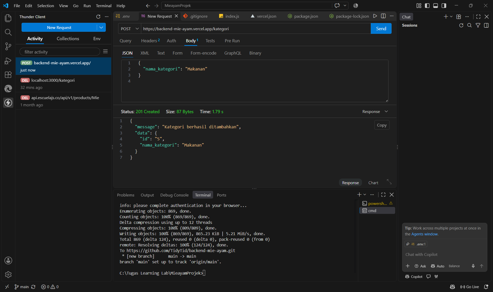
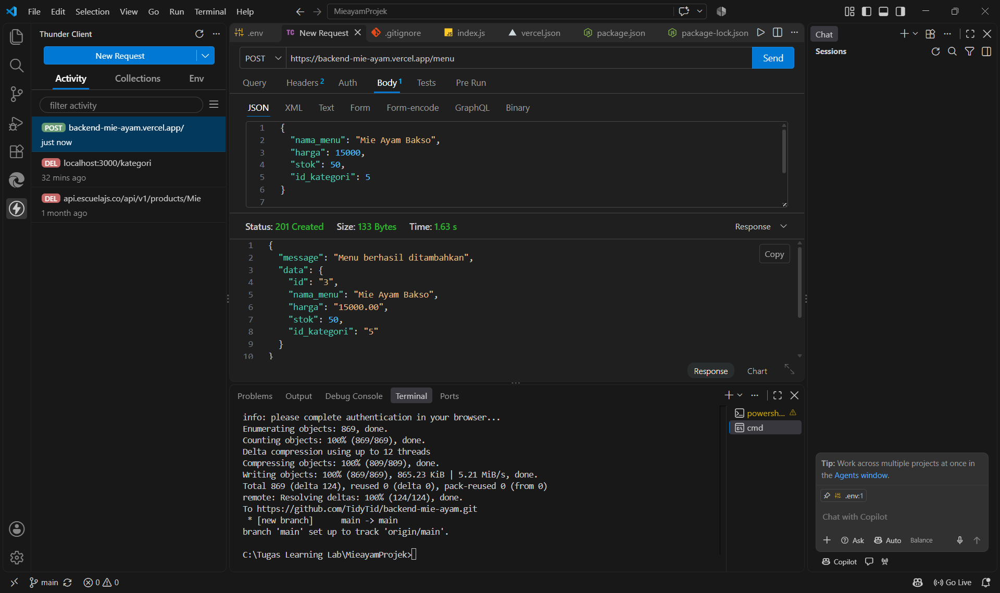
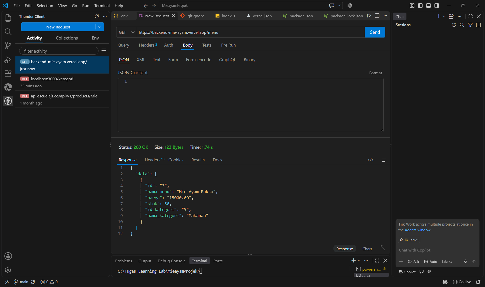
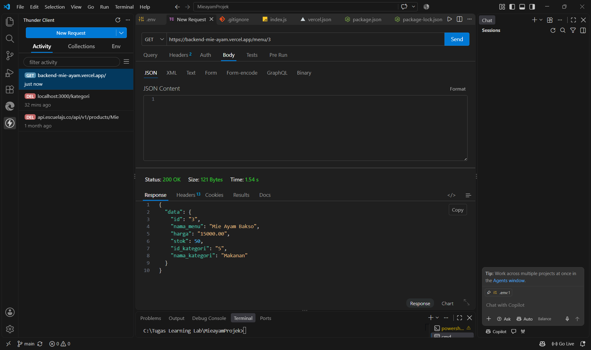
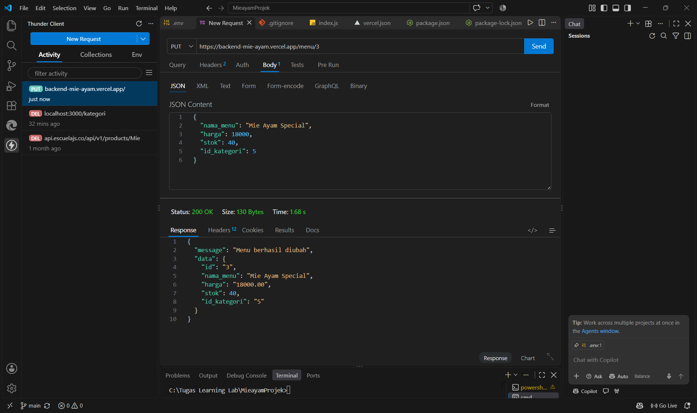
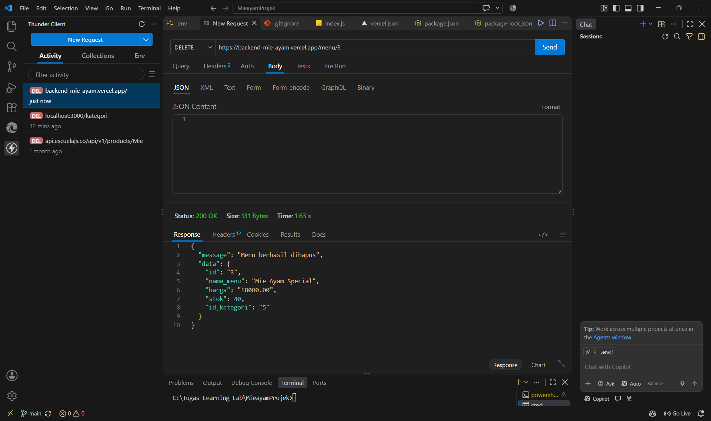

# REST API Pemesanan Mie Ayam

REST API sederhana untuk mengelola kategori dan menu makanan pada sistem pemesanan mie ayam berbasis Node.js, Express, dan PostgreSQL (Supabase).

- **Link Vercel:** https://backend-mie-ayam.vercel.app/
- **Link ERD Diagram:** https://drawsql.app/teams/mabay/diagrams/cobates

---

## Dokumentasi Endpoint API

### 1. POST/kategori

- Method : POST
- URL : https://backend-mie-ayam.vercel.app/kategori
- Deskripsi : Menambahkan kategori makanan baru
- Headers : Content-Type: application/json



```json
- Request Body :
  {
    "nama_kategori": "Makanan"
  }
```

```json
- Responsi sukses (201):
 {
    "message": "Kategori berhasil ditambahkan",
    "data": {
    "id": "5",
    "nama_kategori": "Makanan"
     }
 }
```

### 2. POST/Menu

- Method : POST
- URL : https://backend-mie-ayam.vercel.app/menu
- Deskripsi : Menambahkan menu makanan baru
- Headers : Content-Type: application/json



```json
- Request Body :
 {
     "nama_menu": "Mie Ayam Bakso",
     "harga": 15000,
    "stok": 50,
    "id_kategori": 5
 }
```

```json
- Responsi sukses (201):
 {
    "message": "Menu berhasil ditambahkan",
    "data": {
    "id": "3",
    "nama_menu": "Mie Ayam Bakso",
    "harga": "15000.00",
    "stok": 50,
    "id_kategori": "5"
  }
}
```

### 3. GET/Menu

- Method : GET
- URL : https://backend-mie-ayam.vercel.app/menu
- Deskripsi : Mengambil seluruh daftar menu makanan
- Headers : -



```json
- Request Body : -
```

```json
- Responsi sukses (200):
{
  "data": [
    {
      "id": "3",
      "nama_menu": "Mie Ayam Bakso",
      "harga": "15000.00",
      "stok": 50,
      "id_kategori": "5",
      "nama_kategori": "Makanan"
    }
  ]
}
```

### 4. GET/Menu/id

- Method : GET
- URL : https://backend-mie-ayam.vercel.app/menu/3
- Deskripsi : Mengambil detail 1 menu berdasarkan ID
- Headers : -



```json
- Request Body : -
```

```json
- Responsi sukses (200):
{
  "data": {
    "id": "3",
    "nama_menu": "Mie Ayam Bakso",
    "harga": "15000.00",
    "stok": 50,
    "id_kategori": "5",
    "nama_kategori": "Makanan"
  }
}
```

### 5. PUT/Menu/id

- Method : PUT
- URL : https://backend-mie-ayam.vercel.app/menu/3
- Deskripsi : Mengubah data menu berdasarkan ID
- Headers : Content-Type: application/json



```json
- Request Body :
{
  "nama_menu": "Mie Ayam Special",
  "harga": 18000,
  "stok": 40,
  "id_kategori": 5
}
```

```json
- Responsi sukses (200):
{
  "message": "Menu berhasil diubah",
  "data": {
    "id": "3",
    "nama_menu": "Mie Ayam Special",
    "harga": "18000.00",
    "stok": 40,
    "id_kategori": "5"
  }
}
```

### 6. DELETE/Menu/id

- Method : DELETE
- URL : https://backend-mie-ayam.vercel.app/menu/3
- Deskripsi : Menghapus menu berdasarkan ID
- Headers : Content-Type: application/json



```json
- Request Body : -
```

```json
- Responsi sukses (200):
{
  "message": "Menu berhasil dihapus",
  "data": {
    "id": "3",
    "nama_menu": "Mie Ayam Special",
    "harga": "18000.00",
    "stok": 40,
    "id_kategori": "5"
  }
}
```
